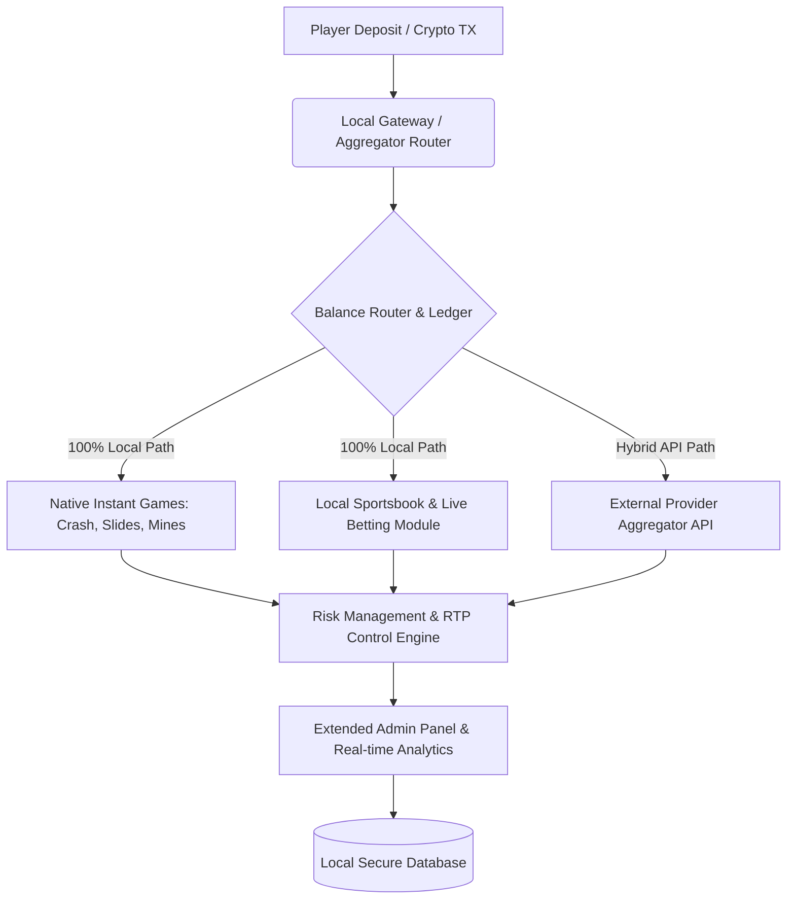

<h1> 🎰 Goldsvet Casino Open Source Engine </h1>    

  

**Next-generation enterprise iGaming software:** Choose your path. A fully localized, dependency-free Laravel engine **OR** a hybrid open-source core with seamless external API integration. Maximum uptime, clean code, and absolute financial autonomy.

## 🚀 Choose Your Deployment Path

This repository offers **two distinct, production-ready configurations** tailored to your business model. Both share the same robust, audited, and unencrypted core architecture.

| 🔹 **Option 1: 100% Local Open-Source Engine** | 🔸 **Option 2: Hybrid Engine (Local + API Providers)** |
| :--- | :--- |
| **Zero external dependencies.** No monthly API fees, no third-party revenue splits. | **Open-source core + External API integration.** Combine local games with premium provider slots. |
| **Built-in Games:** Slots (1100+), Crash, Slides, Mines, Local Sportsbook. | **Built-in Games:** Crash, Slides, Mines, Local Sportsbook **+** 2500+ API Slots/Live Casino. |
| **Payments:** Stripe, PIX, Coinbase Commerce, NowPayments, PaymentWall, PIN Codes. | **Payments:** Same local gateways **+** advanced aggregator wallet routing. |
| **Best for:** Private casinos, multi-brand networks, B2B API providers, budget-conscious startups. | **Best for:** Established operators seeking premium content alongside zero-fee local games. |
| [**🔗 View Option 1 Details & Purchase**](https://mintscripts.net/market/73-mint-scripts-engine-kripto-kazino-laravel-open-source.html) | [**🔗 View Option 2 Details & Purchase**](https://mintscripts.net/market/61-kupit-skript-kazino-pod-kljuch-goldsvet-crypto-casino-s-api-pragmatic-play-i-hacksaw.html) |

## 🖥️ Visual Overview (Option 1: Local Engine)

Experience the sleek, responsive, and highly intuitive interface designed for both players and administrators. 

  
<strong>🎮 Player Frontend Experience</strong>

  
  
    
  
  
<strong>⚙️ Extended Admin Control Panel</strong>

  

## 🏗️ Architecture & Data Flow

The engine is designed for flexibility. Below is the data flow illustrating how the system handles both **100% Local** operations and **Hybrid API** requests seamlessly.

## 💎 Core Features (Included in Both Options)

* **🎰 Native Instant Games:** Autonomous, server-side games (Crash, Slides, Mines) running directly on your infrastructure with **zero monthly third-party traffic fees**.
* **⚽ Standalone Local Sportsbook:** A fully decoupled, local sports betting line (football, basketball, tennis, esports) with customizable odds and margins. No external API fees.
* **💳 Versatile Payment Gateways:** Out-of-the-box support for **Stripe** (cards), **PIX** (instant Brazil), **Coinbase Commerce** & **NowPayments** (crypto), **PaymentWall** (global), and **PIN Code** activation systems. Deploy your own private crypto gateway with ease.
* **🎯 Advanced Retention System:** Multi-tier loyalty programs, player ranks, weekly cashback (up to 15%), dynamic tournaments, free spins shop, and customizable promotional banners.
* **⚙️ Granular RTP Control:** Fine-tune the return-to-player percentage (GDR adjustment at 8%+ level) globally or per-module directly from the admin panel for stable business profitability.
* **🌍 Multi-Currency & Localization:** Multi-currency balances, default currency selection, and min/max limits configurable per payment gateway.

## 🔌 Seamless Aggregator Compatibility (Option 2)

For operators requiring premium third-party content, our engine features pre-configured, modular API connectors. 

> *Disclaimer: The engine provides the technical integration framework. External game content requires valid commercial agreements with respective providers or aggregators.*

The architecture is agnostic and easily integrates with leading global studios and aggregator APIs, including but not limited to:  
`PG Soft` • `Play'n GO` • `EGT` • `iSoftBet` • `Pragmatic Play` • `NetEnt` • `Novomatic` • `Wazdan` • `CQ9` • `BetSoft` • `Amatic` • `Greentube` • `Igrosoft` • `Skywind` • `Keno/Card/Roulette Networks` • `Jackpots & Arcade Modules`.

## 📊 Competitive Matrix

| Comparison Criteria | 🚀 Mint Scripts Engine (This Repo) | ❌ Standard Public Builds |
| :--- | :--- | :--- |
| **Source Code** | **100% Open Source (Laravel)**, unencrypted, fully auditable | Encoded via IonCube, hidden security risks, obfuscated logic |
| **Game Autonomy** | **Built-in Instant Games + Local Sportsbook** (0% fees) | None (every game requires paid API feeds and revenue splits) |
| **Payment Flexibility** | **Local Gateways + PIN + Crypto** (0% intermediary fees) | Paid aggregators only (5% to 12% turnover cut) |
| **Security** | Complete code audit, zero backdoors, local data sovereignty | High risk of hacks, database leaks, and hidden admin accounts |
| **Marketing Tools** | Free spins shop, wheel of fortune, ranks, tournaments, VIP pages | Basic profile and standard slot catalog only |

## ❓ Frequently Asked Questions (FAQ)

**1. What is the difference between Option 1 and Option 2?**  
*Option 1* is a 100% self-contained, local Laravel engine with built-in games and sportsbook. It has zero external dependencies, making it perfect for maximum profit retention and privacy. *Option 2* includes the same powerful local core but adds pre-configured API connectors for integrating external premium slot providers and live casinos.

**2. How are financial security and settlements handled?**  
All settlements occur directly through your configured gateways. For crypto, funds are credited instantly to your designated wallets without intermediaries. The system supports both manual payout audits and fully automated withdrawal modes.

**3. Can I customize the RTP and financial parameters?**  
Yes. The extended admin panel provides granular control over RTP (Return to Player), wagering requirements, bonus limits, and gateway min/max thresholds. You have absolute control over the mathematical model of your platform.

**4. Is the code truly open source?**  
Yes. Unlike public "nulled" builds, this is a professionally modernized, clean-code Laravel architecture. There is no IonCube encoding, no hidden backdoors, and no external phone-home scripts. You own your infrastructure.

  

<strong>Ready to launch your enterprise iGaming platform?</strong>

[**🔗 Get Option 1: 100% Local Open-Source Engine**](https://mintscripts.net/market/73-mint-scripts-engine-kripto-kazino-laravel-open-source.html)  
[**🔗 Get Option 2: Hybrid Engine with API Providers**](https://mintscripts.net/market/61-kupit-skript-kazino-pod-kljuch-goldsvet-crypto-casino-s-api-pragmatic-play-i-hacksaw.html)

 
<em>This material is the intellectual property of Code Core & Mint Scripts Technology Lab.</em> 
<em>© 2026 Mint Scripts — Web3 & iGaming Architectural Engineering.</em>

